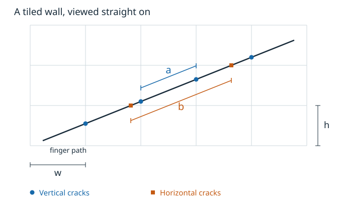
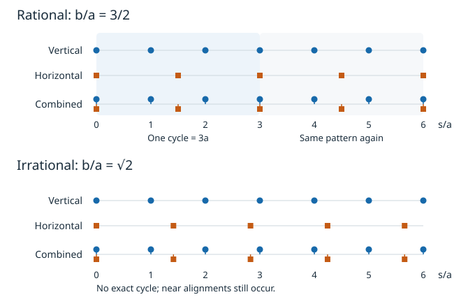

# Do Grid Crossings Always Repeat?

One time, riding down a long airport escalator, I let my finger drag (probably unwisely) along the smooth tiled wall, lifting it over the grout cracks as they approached. The tiles repeated, but the jump sequence didn’t necessarily repeat with any discernible recurring pattern. So naturally, a math problem popped into my head that I spent my entire gate-waiting period thinking about.

> If there is an infinite rectangular grid and a line that crosses through the grid at an angle, are you guaranteed periodicity in the grid-line intersection points (from the line’s 1D perspective) no matter the line angle and grid aspect ratio?

As it turns out, **the crossing pattern repeats (achieving periodicity) exactly when the path's slope, measured in tile units, is a rational number.** So periodicity is not guaranteed *despite the inherent periodicity in the geometry of the problem*; stated differently, individually periodic sequences can combine into a pattern that never repeats, and that 1D stipulation is how you should frame this 2D problem (and its unexpected applications).

## Two sets of periodic "ticks"

Let the tiles have width \\(w\\) and height \\(h\\), and let the path make angle \\(\theta\\) with the horizontal. Measure distance \\(s\\) along the path. Initially assume it crosses both families of grid lines.

Between successive vertical cracks, the horizontal displacement is \\(w\\); between horizontal cracks, the vertical displacement is \\(h\\). The two spacings along the path are therefore

\\[
a=\frac{w}{|\cos\theta|},\qquad
b=\frac{h}{|\sin\theta|}.
\\]

The crossing locations form two arithmetic progressions,

\\[
A=\{\alpha+na:n\in\mathbb Z\},\qquad
B=\{\beta+mb:m\in\mathbb Z\}.
\\]

The offsets \\(\alpha,\beta\\) depend on where the path starts. They affect the arrangement of crossings, but not whether it repeats. At constant escalator speed \\(v\\), the corresponding time periods are \\(a/v\\) and \\(b/v\\), with the same ratio.

## When the rhythms repeat

A common repeat distance \\(L>0\\) must contain a whole number of steps from each sequence:

\\[
L=qa=pb
\quad\Longleftrightarrow\quad
\frac{a}{b}=\frac{p}{q}\in\mathbb Q.
\\]

If \\(p,q\\) are positive coprime integers, \\(L=qa=pb\\) is the smallest repeat distance that preserves both sequences separately. Shifting by \\(L\\) reproduces every crossing, whatever the offsets. Geometrically, the criterion is

\\[
\boxed{\frac{w}{h}|\tan\theta|\in\mathbb Q.}
\\]

Rescaling the coordinates to \\(x/w,y/h\\) turns the rectangles into unit squares; the boxed quantity is the absolute slope in those coordinates. The angle itself need not be a rational number of degrees or radians.

But my finger doesn't label cracks “horizontal” or “vertical.” Could the **unlabeled union** \\(A\cup B\\) repeat even when \\(a/b\\) is irrational? No. Here is the missing step:

* Suppose shifting by \\(L\\) preserves the union. If \\(L\\) is not an integer multiple of \\(a\\), none of the shifted \\(A\\) ticks land in \\(A\\), so all must land in \\(B\\).
* Two consecutive shifted ticks are distance \\(a\\) apart. Two ticks in \\(B\\) differ by an integer multiple of \\(b\\), forcing \\(a/b\\) to be an integer—a contradiction.
* Thus \\(L\\) must be an integer multiple of \\(a\\). Swapping the roles forces it to be an integer multiple of \\(b\\) too, again contradicting irrationality.

So the rationality criterion holds even when simultaneous crossings count as one jump. For rational ratios, merging the labels can sometimes shorten the smallest period: ticks at even integers and ticks at odd integers each have period 2, while their union has period 1.

## Examples you can see

For unit square tiles and slope \\(2/3\\), we get \\(a=\sqrt{13}/3\\), \\(b=\sqrt{13}/2\\), and \\(L=\sqrt{13}\\). Starting at a corner, one cycle's crossing locations are

\\[
\frac{s}{L}:\quad 0,\ \frac13,\ \frac12,\ \frac23,\ 1.
\\]

The successive gaps are \\(L/3,L/6,L/6,L/3\\), then repeat. A repeating pattern need not have equally spaced events.

For unit squares and slope \\(1/\sqrt2\\), instead \\(b/a=\sqrt2\\): no exact period exists. Near repeats can still be convincing. Since \\(\sqrt2\approx99/70\\), advancing \\(99a\\) returns the first rhythm exactly and misses \\(70b\\) by only about \\(0.00505a\\). A finite ride can hide the difference between “almost” and “exactly.”

Aspect ratio matters: on tiles twice as wide as they are tall, slope \\(1/2\\) gives \\(a=b\\), so the pattern repeats. Conversely, slope 1 on tiles with \\(w/h=\sqrt2\\) is aperiodic.

## More rhythms, and useful algorithms

For a finite collection of positive spacings \\(T_1,\ldots,T_N\\), a common cycle exists exactly when every ratio \\(T_i/T_1\\) is rational. Checking adjacent ratios also suffices: multiplying them gives every ratio to the first. If \\(T_i/T_1=p_i/q_i\\) in lowest terms, a common cycle is

\\[
L=T_1\,\operatorname{lcm}(p_1,\ldots,p_N).
\\]

Each \\(L/T_i\\) is then an integer. Conversely, any common cycle gives \\(T_i/T_j=(L/T_j)/(L/T_i)\\), a ratio of integers. Individual spacings may themselves be irrational; what matters is their ratios.

Two practical uses:

* **Grid traversal.** Keep the next vertical and horizontal crossing distances. Take the smaller and advance that sequence by \\(a\\) or \\(b\\); at a corner, advance both for a single crossing event. This is the core idea behind [Amanatides and Woo's voxel traversal algorithm](https://flipcode.com/archives/A%20faster%20voxel%20traversal%20algorithm%20for%20ray%20tracing.pdf), extended to three axes. It generates crossings efficiently even without a repeating cycle. Which cells to include when a ray only touches their corner requires an explicit boundary convention.
* **Periodic task releases.** Timers firing every 2, 3, and 5 milliseconds have a joint release pattern that repeats every 30 milliseconds: their [hyperperiod](https://prosa.mpi-sws.org/branches/master/without-proofs/prosa.analysis.definitions.hyperperiod.html). One cycle can represent the release pattern, though meeting execution deadlines is a separate scheduling problem. Integer clock ticks guarantee rational ratios, but a large least common multiple can make precomputing a cycle impractical.

The model treats grout as lines of zero width. A path parallel to one family crosses only the other and is periodic; a path lying directly on a grid line has continuous contact, outside this discrete model. Real tiles, motion, and measurements have tolerances, so a short observed rhythm cannot establish exact mathematical periodicity.
